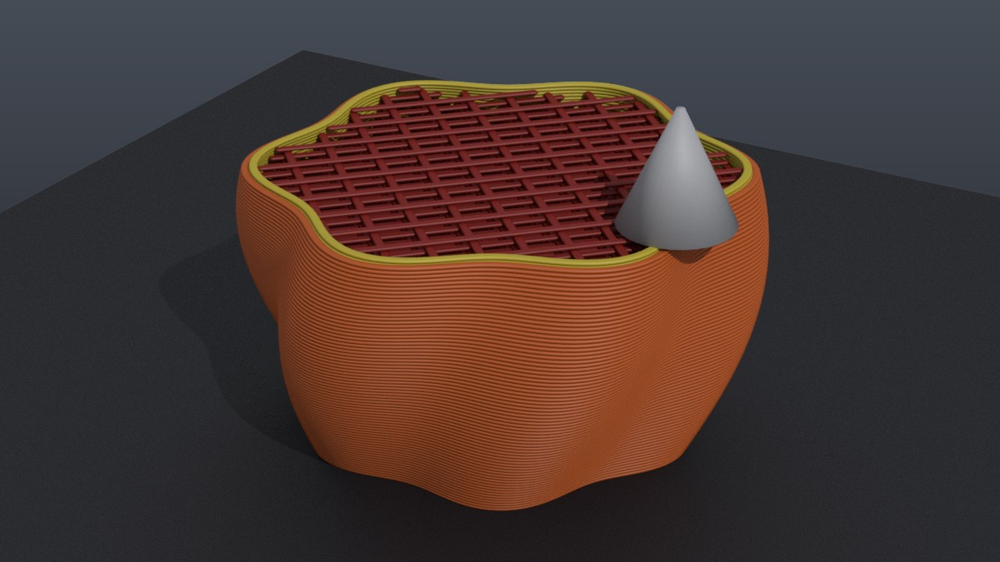
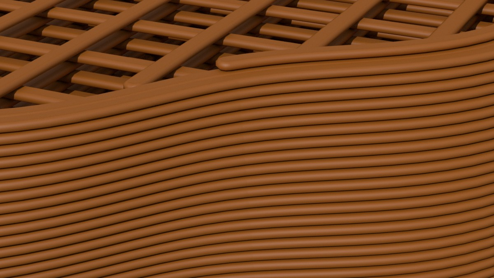

# G-code Import for Houdini

A self-contained SOP asset that reads 3D-printer G-code and turns it into render-ready
geometry: the nozzle path as curves, or the printed beads themselves with the slicer's
cross-section, plus attributes for shading and for animating the print.



## Features

- **Reads what slicers write.** G0/G1, arcs G2/G3 (I/J or R form, helical, full turns
  with P), absolute and relative positioning and extrusion, G92, inches, tool changes.
  Feature type, layer, layer height and object come from the slicer's comments
  (Bambu Studio, OrcaSlicer, PrusaSlicer, Cura and Simplify3D conventions).
- **Curves or Tubes.** Curves are polylines along the nozzle path. Tubes are the beads:
  a rectangle with round ends (the slicers' own bead model), as wide as the extruded line
  and as tall as its layer, with the top at the nozzle tip and exact normals. Bead ends
  are round like the nozzle's footprint. Gentle corners are mitred; sharp ones are cut
  into overlapping pieces, so the mesh never folds.
- **Real bead width.** Width comes from the extruded volume and the flow ratio, so
  Arachne's variable width and tapering scarf seams look the way they were printed.
- **Real timing.** Every point knows when it was printed. The feed-rate clock is fitted
  to the slicer's own estimate (`M73` marks or Cura's `TIME_ELAPSED`), so the pace
  matches the actual print.
- **Animation.** The Progress parameter grows the print over time; the bead being laid
  down ends exactly at the nozzle. A second output gives the nozzle position.
- **Colour** by filament (the slicer's filament colours, per tool) or by feature (the
  slicer preview palette).
- **Self-contained.** One `.hda` file, nothing to install into Houdini's Python. The file
  is read by a Python SOP that uses only the standard library; everything else is VEX and
  stock nodes.



## Install

1. Download [`gcode.hda`](gcode.hda).
2. In Houdini choose **Assets → Install Asset Library…** and pick the file. To carry the
   asset inside a scene, install it into the current HIP file.
3. In a geometry network press Tab → **Import → G-code Import** and set *G-code File*.

Built and tested with Houdini 22.0. To try it without a printer file, use
[`examples/demo_vase.gcode`](examples/demo_vase.gcode), a small synthetic print in Bambu
Studio style.

## Parameters

| Parameter | What it does |
| --- | --- |
| G-code File | The file to read. Other parameters do not re-read it. |
| Reload | Re-reads the file after it was saved again under the same name. |
| Geometry | *Curves*: nozzle-path polylines. *Tubes* (default): bead geometry. |
| Round End Divisions | Segments on each round side of the bead section. 2 is a hexagon, 3–4 suit close-ups. |
| Polygon Soups | Packs each bead into a polygon soup: same render, a fraction of the memory. |
| Travel Moves | Adds travel and wipe moves (group `travel`). They stay curves in Tubes mode. |
| Start/End G-code | Adds the printer's start and end code: purge lines, calibration (group `custom`). |
| Arc Tolerance | How far a G2/G3 arc may deviate from its polyline, in millimetres. |
| Y Up | Turns the printer's Z-up space into Houdini's Y-up, like Rotate X = -90. |
| Origin | *G-code*: printer coordinates. *Bed Centre*: the bed centre at the origin. *Print Centre*: the print centred on the origin. The bed stays at height 0. |
| Scale | 1 makes one scene unit a millimetre; 0.001 gives metres. |
| Colour | *Filament*: the slicer's filament colour. *Feature*: preview colours by line type. |
| Progress | How much is printed, 0 to 1 of the print time. Animate it to print the model. |

## Attributes

| Class | Attribute | Meaning |
| --- | --- | --- |
| point | `width` | Bead width, in scene units. Karma uses it as the curve width. |
| point | `height` | Bead height (the layer height; Bambu's thick bridges are taller). |
| point | `time` | Seconds since the print started. |
| point | `speed` | Nozzle speed, mm/s. |
| point | `N` | Tubes only: exact bead normals. |
| primitive | `feature` | Line type as the slicer named it: `Outer wall`, `Sparse infill`, `Bridge`… Travel moves are `Travel` or `Wipe`. |
| primitive | `layer` | Layer number, from 0. |
| primitive | `object` | Object on the bed (the slicer's name or id). |
| primitive | `tool` | Extruder or filament slot. |
| primitive | `Cd` | Colour, see the Colour parameter. Linear, converted from the slicer's sRGB. |
| group | `travel`, `custom` | Travel/wipe moves; start/end G-code. |
| detail | `print_time`, `layer_count`, `filament_colour`, `nozzle_diameter`, `slicer`, `source` | File-level values. |

The **Nozzle** output is a single point with `time`, `extruding` (1 while laying down
plastic), `speed`, `feature`, `layer` and `Cd`.

## Recipes

- **Print in 10 seconds at 24 fps:** set Progress to `$F / 240`.
- **Print head:** Copy to Points a nozzle model onto the second output.
- **Outer surface only:** Blast with `@feature!="Outer wall"` keeps just the visible walls,
  a fraction of the geometry for wide shots.
- **Hot trail behind the nozzle:** compare `@time` with the current print time
  (`Progress × print_time`) in a wrangle or a shader.

## How it works

A Python SOP reads the file into polylines in G-code space: one polyline per
uninterrupted run of the same kind (extrusion, travel or wipe) with the same feature,
layer, object and tool. Per-move values (width, height, speed, time) sit on the points.
VEX wrangles then place the result (axis, origin, scale), colour it, drop travel and
custom code, and cut it at Progress. For tubes, a wrangle drops points too close to give a
direction and cuts runs at corners one cross-section cannot turn. The stock Sweep SOP
builds the mesh and carries the attributes, and a final wrangle places every point on the
exact bead section and round ends.

## Building from source

The asset is generated from the sources in this repository:

```
hython build.py              # writes gcode.hda
hython test.py [file.gcode]  # synthetic files with known answers, plus an optional real file
```

`parse.py` is the Python SOP code, `vex/` holds the wrangles. For Bambu Studio files,
`test.py` checks the layer count, top height and print time against the file's header.

## Limitations

- Binary G-code (`.bgcode`) is not supported.
- Arcs are read in the XY plane only (G17), which is what slicers write.
- Within each `M73` interval, timing follows feed rates; acceleration is not simulated.
- Tested on Bambu Studio output and on synthetic files in Prusa, Cura and Orca styles.
- The node's built-in help card is in Russian for now; this README is the English
  reference.

## License

[MIT](LICENSE)
